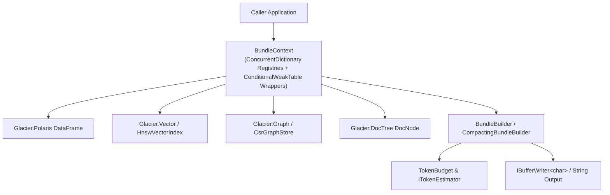

# Glacier.Bundle Architecture

`Glacier.Bundle` acts as an orchestration layer above `Glacier.Polaris`, `Glacier.Graph`, `Glacier.DocTree`, and `Glacier.Vector`, keeping each backend store independent while sharing pooled scratch memory during prompt assembly.

## 1. Component Overview

## 2. Design Invariants

- **Non-Owning Thread-Safe Registry (`BundleContext`):** Stores live in `ConcurrentDictionary<string, ...>` maps and remain owned/disposed by the caller. Stateless search helpers (`GraphSearch`, `CsrGraphSearch`, `TreeSearch`) are memoized per store instance via `ConditionalWeakTable` so repeated builder calls avoid wrapper allocations without pinning collected stores.
- **Pooled Query Scratch Buffers:** `AppendHnswVectorContext` and `AppendCsrGraphTopology` rent working buffers from `ArrayPool<T>.Shared` instead of allocating managed arrays on every lookup.
- **Native AOT Compatibility:** Strong typing (`RegisterDataFrame`, `RegisterTabularData<T>`, `<IsAotCompatible>true</IsAotCompatible>`) eliminates runtime `dynamic` binding.
- **Grapheme-Safe Budgeting:** `HeuristicTokenEstimator.TruncateToTokens` and `TokenBudget.TruncateHeadTail` align truncation offsets to `System.Globalization.StringInfo` text elements and whitespace boundaries, preventing torn UTF-16 surrogates, `\r\n` splits, or broken multi-codepoint sequences.
- **Zero-String Streaming (`WriteTo`):** `CompactingBundleBuilder.WriteTo(IBufferWriter<char>)` writes formatted headers, table slices, and sections directly into caller-provided `IBufferWriter<char>` spans.
